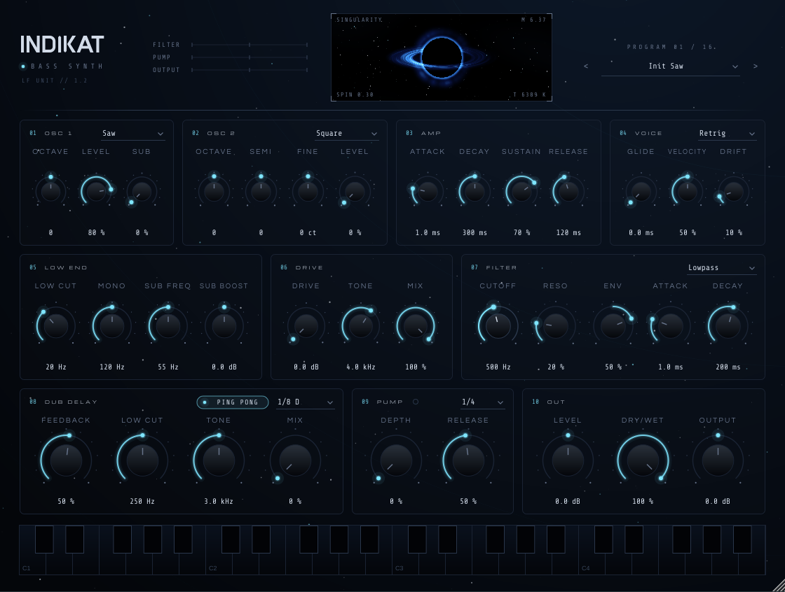
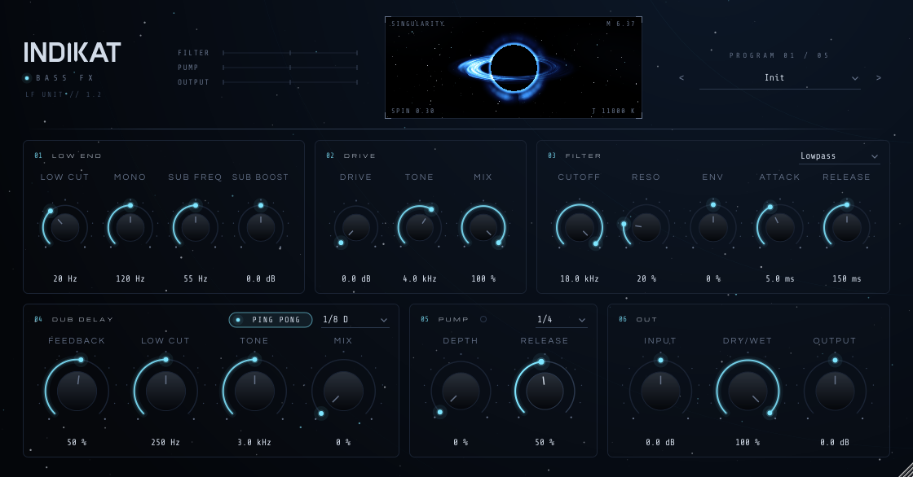

# INDIKAT Bass Synth / INDIKAT Bass FX

Zwei VST3/AU-Plugins (JUCE 8) für Basslines im Minimal-Dub- und Dub-Techno-Stil, aus einer Codebasis:

| Plugin | Typ | Wofür |
|---|---|---|
| **INDIKAT Bass Synth** | Instrument (MIDI) | Monophoner Bass-Synth mit 2 Oszillatoren + Sub und kompletter Effektkette |
| **INDIKAT Bass FX** | Audio-Effekt | Dieselbe Effektkette für vorhandene Basslines (Samples, andere Synths) |




## Synth

- **OSC 1**: Sine / Triangle / Saw / Square / Pulse, Oktave, Level, plus **Sub** (Sinus eine Oktave tiefer)
- **OSC 2**: gleiche Wellenformen, Oktave, Halbtöne, Feinstimmung (für Quinten-/Septimen-Stabs oder Schwebung)
- **AMP**: ADSR mit exponentiellem Decay/Release
- **VOICE**: Glide (Portamento), Retrig/Legato, Velocity-Empfindlichkeit, analoger Drift
- Saw/Square mit PolyBLEP (wenig Aliasing), Phasen-Reset bei jeder neuen Note für einen gleichbleibenden Punch
- Im Synth steuert eine eigene **Filter-Hüllkurve** (Attack/Decay) den Filter, im FX ein Envelope Follower

## Effektkette (beide Plugins)

```
[Synth | Input] → Low Cut → Mono-Bass → Sub Boost → Drive → Filter → Dub Delay → Pump → Out
```

| Sektion | Wofür |
|---|---|
| **LOW END** | Low Cut gegen Rumpeln, alles unter „Mono“ wird mono (clubtauglich), Sub per Low-Shelf anheben |
| **DRIVE** | Asymmetrische Sättigung mit Tone, parallel mischbar |
| **FILTER** | Resonantes LP/BP/HP, von der Hüllkurve moduliert; ENV ist bipolar (violett = schließend) |
| **DUB DELAY** | Tempo-synchron, Ping Pong, gesättigtes und gedämpftes Feedback. Der Low Cut hält den Sub aus dem Echo |
| **PUMP** | Sidechain-artiges Ducking synchron zur DAW (1/4, 1/8, 1/2) |
| **OUT** | Level/Input, Dry/Wet, Output |

## Singularity (Schwarzes Loch)

Das Fenster im Header zeigt ein Schwarzes Loch, das in Echtzeit berechnet wird (Gravitationslinse,
Akkretionsscheibe, Photonenring). Es folgt den Parametern und dem Audiosignal
([Video](docs/blackhole.mp4)):

| Parameter | Wirkung |
|---|---|
| Sub Boost, Level/Input, Low Cut | Masse (Größe des Horizonts), federt nach |
| Ausgangspegel, Pump | Pulsieren und Atmen im Takt |
| Cutoff | Temperatur: tiefes Blau → Eis-Cyan → Weißglut |
| Resonanz | Schärfe und Helligkeit des Photonenrings |
| Drive | Crunch: Farbversatz, Körnung, Bitcrush-Stufen |
| Delay Feedback/Mix | Echo-Ringe um den Horizont |
| Mono | Neigung der Scheibe |
| Dry/Wet | Dichte der Scheibe |
| Synth: Wellenform, Drift, OSC 2 | Textur der Scheibe, Wackeln, Doppel-Photonenring |

**Jede Parameteränderung**, auch durch Automation, löst einen Effekt aus: Partikel spiralen ins Loch,
Schockwellen laufen nach außen, und Name und Wert werden kurz eingeblendet. Je nach Gruppe sieht der Effekt
anders aus: Drive glitcht, Delay erzeugt Echo-Wellen, Low End lässt das Loch schlucken, Filter flackert auf.
Bei einem Preset-Wechsel kollabiert das Loch kurz und zeigt den Preset-Namen.

## Presets

**Synth (16):** Init Saw, Deep Sub Pluck, Dub Chord Stab, Minor Seventh Stab, Rubber Bass, Warm Round,
Minimal Click Bass, Acid Glide, Detuned Wobble, Sub Only, Warehouse Pump Bass, Echo Dub Bass, Hollow Pulse,
Tape Deep, Fifth Pluck, Night Drive. Alle sind auf etwa −16 dBFS RMS angeglichen.

**FX (5):** Init, Deep Chord Dub, Rolling Sub, Warehouse Pump, Echo Chamber

## Bedienung

- Ziehen = Wert ändern, **Doppelklick** = Standardwert, Mausrad funktioniert
- Das Fenster ist frei skalierbar (Ecke unten rechts)
- Mit `<` / `>` blätterst du durch die Presets, ein Klick auf den Namen öffnet die Liste
- Mit der Bildschirm-Tastatur (Synth) spielst du Presets auch ohne MIDI-Controller an

## Bauen

Voraussetzungen: CMake ≥ 3.22 und ein C++17-Compiler (Windows: Visual Studio 2022, macOS: Xcode).
JUCE wird automatisch heruntergeladen.

```bash
cmake -B build -DCMAKE_BUILD_TYPE=Release
cmake --build build --config Release
```

Ergebnis:
- `build/IndikatBassSynth_artefacts/Release/VST3/INDIKAT Bass Synth.vst3`
- `build/IndikatBassFX_artefacts/Release/VST3/INDIKAT Bass FX.vst3`

Installieren: Windows `C:\Program Files\Common Files\VST3\`, macOS `~/Library/Audio/Plug-Ins/VST3/`
(AU: `~/Library/Audio/Plug-Ins/Components/`), Linux `~/.vst3/`. Danach in der DAW neu scannen.

**Ohne Compiler:** Repository auf GitHub hochladen. Unter **Actions** baut `.github/workflows/build.yml`
automatisch Versionen für Windows, macOS und Linux zum Herunterladen.

**Offline-Test:** `cmake -B build -DINDIKAT_TESTS=ON` baut `IndikatRenderTest`. Das Programm rendert jedes
Synth-Preset mit einer Bassline als WAV und prüft auf NaN und Übersteuerung.

## Lizenzen

Schriften: Michroma, Questrial, Share Tech Mono (SIL Open Font License).
JUCE: AGPLv3 oder kommerzielle JUCE-Lizenz. Wer die Plugins verkaufen oder als Closed Source weitergeben will,
braucht eine JUCE-Lizenz.
