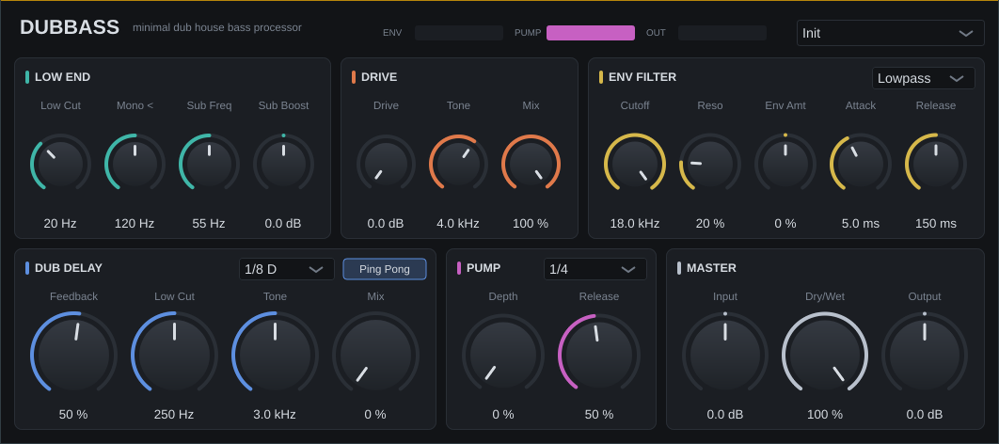

# DubBass – Minimal Dub House Bass Processor

VST3/AU-Effekt-Plugin (JUCE 8) zum Bearbeiten von Basslines im Minimal-Dub-/Deep-House-Stil.
Einfach auf die Bass-Spur legen.



## Signalfluss

```
Input → Low Cut → Mono-Bass → Sub Boost → Drive → Env Filter → Dub Delay → Pump → Dry/Wet → Output
```

| Sektion | Regler | Wofür |
|---|---|---|
| **LOW END** | Low Cut, Mono <, Sub Freq, Sub Boost | Rumpeln entfernen, alles unter der Crossover-Frequenz mono machen (clubtauglich), Sub per Low-Shelf anheben |
| **DRIVE** | Drive, Tone, Mix | Asymmetrische Röhren-artige Sättigung (Obertöne → Bass hörbar auf kleinen Boxen), parallel mischbar |
| **ENV FILTER** | Typ (LP/BP/HP), Cutoff, Reso, Env Amt, Attack, Release | Resonanter Filter, der dem Pegel folgt – der klassische „Wobble/Wah“ der Dub-Chords & Basslines. Env Amt ist bipolar (öffnet oder schließt) |
| **DUB DELAY** | Zeit (tempo-sync), Ping Pong, Feedback, Low Cut, Tone, Mix | Bandecho-artiges Delay mit Sättigung und Tiefpass im Feedback. Der Low Cut hält Sub-Frequenzen aus dem Delay → der Bass bleibt tight, nur die Obertöne echoen |
| **PUMP** | Rate, Depth, Release | Tempo-synchrones Sidechain-Ducking (folgt der DAW-Position) |
| **MASTER** | Input, Dry/Wet, Output | Gain-Staging und Parallel-Mix |

**Presets:** Init, Deep Chord Dub, Rolling Sub, Warehouse Pump, Echo Chamber (Preset-Menü oben rechts).

## Bauen

Voraussetzungen: CMake ≥ 3.22 und ein C++17-Compiler
(Windows: Visual Studio 2022 mit „Desktopentwicklung mit C++“, macOS: Xcode).
JUCE wird automatisch heruntergeladen.

```bash
cmake -B build -DCMAKE_BUILD_TYPE=Release
cmake --build build --config Release
```

Ergebnis: `build/DubBass_artefacts/Release/VST3/DubBass.vst3`

### Installieren
- **Windows:** `DubBass.vst3` nach `C:\Program Files\Common Files\VST3\` kopieren
- **macOS:** nach `~/Library/Audio/Plug-Ins/VST3/` (AU: `~/Library/Audio/Plug-Ins/Components/`)
- **Linux:** nach `~/.vst3/`

Danach in der DAW neu scannen.

### Ohne eigenen Compiler
Repository auf GitHub hochladen → unter **Actions** baut der Workflow `.github/workflows/build.yml`
automatisch Windows-, macOS- und Linux-Versionen, die du als Artefakt herunterladen kannst.

## Tipps für Minimal Dub
- **Mono <** auf 100–150 Hz: Sub bleibt mono und phasenstabil.
- Env Filter: Cutoff 400–900 Hz, Reso 30–50 %, Env Amt 40–60 %, Release 150–250 ms → der typische „atmende“ Bass.
- Delay auf 1/8 D oder 3/16-Feeling mit Low Cut 250–400 Hz – Echos ohne Matsch im Low End.
- Pump leicht (20–30 %) auch wenn schon ein Sidechain-Kompressor läuft: gibt Groove.
