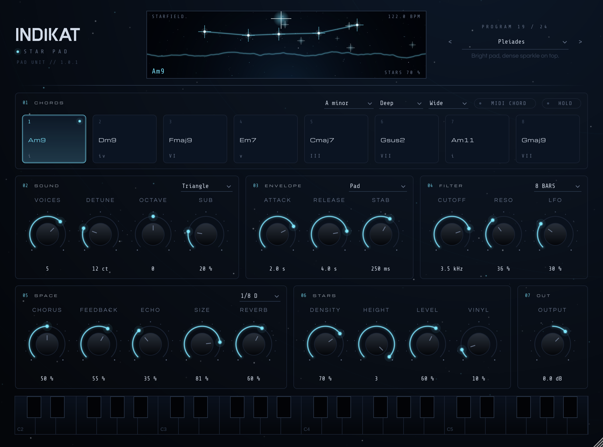

# INDIKAT Star Pad

Pad-Synth für Minimal und Dub House (VST3 / AU / Standalone, JUCE 8). 24 Presets, Akkord-Pads,
tempo-synchrone Dub-Stabs, Echo, Hall und funkelnde „Sterne“.



Star Pad meldet sich als **Instrument**: auf eine Instrument- bzw. MIDI-Spur laden und mit MIDI-Noten
oder den 8 Akkord-Pads in der Oberfläche spielen.

## Spielen

- **8 Akkord-Pads** (Sektion 01): klicken und halten. **HOLD** lässt den Akkord weiterklingen, bis du das Pad nochmal klickst.
  Tonart rechts oben (Moll), Akkord-Satz **Deep** (m9/maj9), **Dub** (m7-Stabs) oder **Fifths** (Quinten), Lage **Wide**/**Close**.
- **MIDI**: Noten aus der Piano-Roll spielen den Pad polyphon. Mit **MIDI CHORD** löst jede einzelne Note einen
  ganzen Akkord aus (Qualität nach Akkord-Satz).
- **Puls** (Sektion 03): Statt einer Fläche spielt Star Pad kurze Stabs im 16tel-Raster des Hosts:
  Offbeat, Dub (`x··x··x···x··x··`), Syncopated oder Eighths. **STAB** ist die Länge eines Stabs.

## Sektionen

| Sektion | Wofür |
|---|---|
| **SOUND** | Wellenform (Saw, Square, Triangle, Sine), 1–7 Unison-Stimmen, Verstimmung, Oktave, Sub (Sinus eine Oktave unter dem Grundton) |
| **ENVELOPE** | Attack, Release, Stab-Länge, Puls-Muster |
| **FILTER** | 24-dB-Tiefpass, Resonanz, LFO synchron zum Host (1 bis 32 Takte) |
| **SPACE** | Chorus, Ping-Pong-Echo (1/8, 1/8 D, 1/4, 1/4 D) mit gefiltertem Feedback, dunkler FDN-Hall |
| **STARS** | Glöckchen aus den Akkordtönen, 2–4 Oktaven höher: Dichte, Höhe, Pegel. Dazu Vinyl-Knistern |
| **OUT** | Ausgangspegel (mit sanfter Sättigung) |

Das Fenster im Header zeigt das **Sternbild** des gehaltenen Akkords, jedes Glöckchen als Funken
(violett = Quinte) und den Ausgang als Horizontlinie.

## Presets

| Deep | Dub | Minimal | Stars |
|---|---|---|---|
| Andromeda | Orion Dub | Polaris | Pleiades |
| Vega | Sirius Echo | Rigel | Shooting Star |
| Milky Way | Comet Tail | Mira | Stardust |
| Nebula | Dark Matter | Quasar | Cassiopeia |
| Lyra | Pulsar | Zenith | Night Sky |
| Deneb | Echo Chamber | Nadir | Supernova |

## Installieren

Jeder Push auf den Branch `starpad` baut Windows, macOS und Linux und veröffentlicht die ZIPs als Release
(`starpad-build-…`).

- **Windows:** ZIP entpacken, `INDIKAT Star Pad.vst3` nach `C:\Program Files\Common Files\VST3\` kopieren,
  in FL Studio nach neuen Plugins scannen. `INDIKAT Star Pad.exe` ist die Standalone-Version.
- **macOS:** `.vst3` nach `~/Library/Audio/Plug-Ins/VST3/`, `.component` nach `~/Library/Audio/Plug-Ins/Components/`.
  Danach im Terminal: `xattr -dr com.apple.quarantine ~/Library/Audio/Plug-Ins/VST3/INDIKAT* ~/Library/Audio/Plug-Ins/Components/INDIKAT*`
- **Linux:** `.vst3` nach `~/.vst3/`.

## Bauen

```
cmake -B build -DCMAKE_BUILD_TYPE=Release
cmake --build build --config Release
```

JUCE 8.0.4 wird automatisch geladen (oder `-DJUCE_DIR=…`). Offline-Test, der Demo-WAVs nach `demos/` rendert:
`cmake -B build -DSTARPAD_TESTS=ON && cmake --build build --target StarPadRender`.
Weitere Tests: `StarPadPresets` (alle Presets, Pegel), `StarPadStress` (Zufallsautomation), `StarPadPerf` (CPU),
`StarPadScreenshot` (rendert `docs/starpad.png`, unter Linux mit Xvfb).
