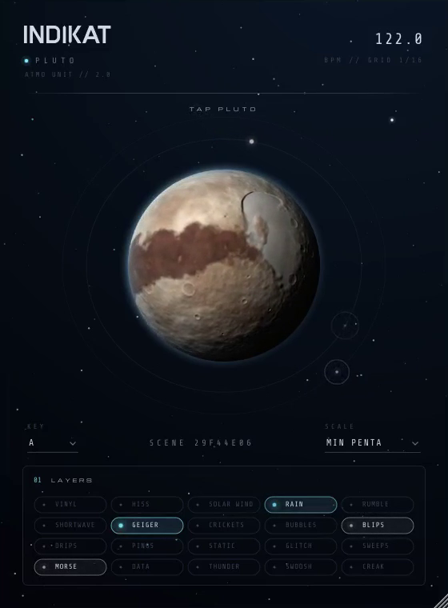

# INDIKAT Pluto

Atmo-Generator für Minimal Dub House (VST3 / AU / Standalone, JUCE 8). **Kein Regler. Ein Klick auf Pluto würfelt eine neue Atmo.**

Pluto meldet sich als **Instrument/Generator**: Es kommt auf eine Instrument- bzw. MIDI-Spur und erzeugt die Atmo komplett selbst, MIDI-Noten braucht es nicht.



## So funktioniert's

Jeder Klick auf den Planeten erzeugt eine neue **Szene**. Eine Szene legt zufällig fest:

- **1–3 Flächen** (laufen durchgehend): Vinyl, Hiss, Solar Wind, Rain, Rumble, Shortwave, Geiger (Geigerzähler mit Strahlungsschauern), Crickets, Bubbles
- **1–3 Ereignis-Typen** (tauchen sparsam im 16tel-Raster des Hosts auf, bevorzugt auf Offbeats): Blips, Drips, Pings, Static, Glitch, Sweeps, Morse, Data (Modem-Bursts), Thunder, Swoosh (Rückwärts-Hall, endet auf dem Schlag), Creak (Rumpf-Knarzen)
- wie dicht die Ereignisse kommen und wie die Flächen klingen (Knisterdichte, Regenstärke, Lage von Wind, Rumpeln und Kurzwelle)
- **Dub-Delay**: Zeiten (z. B. punktierte Achtel / Viertel), Feedback
- **Raum**: Hallgröße und -anteil, Helligkeit, Stereobreite

Beim Wechsel blenden die alten Flächen weich aus und die neuen ein. Unten unter **LAYERS** siehst du, welche Elemente gerade aktiv sind; sie leuchten mit ihrer Aktivität. Ereignisse erscheinen als Funken auf der Umlaufbahn (violett = Glitch).

Die Szene wird mit dem Projekt gespeichert (Seed unter dem Planeten) und beim Öffnen genau so wiederhergestellt.

## Trigger

Oben rechts: **MIDI GATE** (Standard) oder **ALWAYS ON**.

- **MIDI GATE:** Pluto spielt nur, solange eine MIDI-Note gehalten wird. In der Piano Roll also einfach eine lange Note über den Abschnitt ziehen, in dem die Atmo laufen soll. Beim Loslassen klingen Delay und Hall natürlich aus.
- **ALWAYS ON:** Pluto läuft durchgehend (Standard in der Standalone-Version).

Der Punkt neben dem Schalter leuchtet, solange Pluto spielt.

## Elemente selbst wählen

Ein Klick auf ein Element unter **LAYERS** schaltet es in der aktuellen Szene an oder aus. Die Szenennummer bekommt dann ein `*`. Die Auswahl wird mit dem Projekt gespeichert. Ein Klick auf Pluto würfelt wieder alles neu.

## Tonart

Unten links **KEY** (Grundton) und rechts **SCALE** (Minor, Major, Dorian, Phrygian, Moll-/Dur-Pentatonik, Harmonisch Moll, Blues). Alle tonalen Elemente (Blips, Pings, Drips, Morse, der Kurzwellen-Pfeifton) bleiben in dieser Tonleiter. Beides ist automatisierbar und wird mit dem Projekt gespeichert. Standard: A Moll-Pentatonik.

Die meisten Elemente sind bewusst Geräusche ohne Tonhöhe; die tonalen werden vom Randomizer etwas seltener gewählt.

## Einsatz

- Auf eine Instrument-/MIDI-Spur laden. Pluto spielt sofort los, der Takt kommt vom Host.
- Lautstärke über den Kanal-Fader der DAW.
- Läuft der Host nicht, nutzt Pluto einen internen Takt mit dem zuletzt gemeldeten Tempo (Standard 122 BPM).

## Bauen

Benötigt CMake ≥ 3.22 und JUCE 8 (erwartet unter `../JUCE` oder per `-DJUCE_DIR=...`).

```bash
git clone --depth 1 --branch 8.0.4 https://github.com/juce-framework/JUCE.git ../JUCE
cmake -B build -DCMAKE_BUILD_TYPE=Release
cmake --build build --config Release
```

Ergebnis: `build/IndikatPluto_artefacts/Release/VST3/INDIKAT Pluto.vst3` (unter macOS zusätzlich AU).

Ohne `../JUCE` lädt CMake JUCE automatisch herunter.

Windows-, Mac- und Linux-Builds macht GitHub Actions bei jedem Push auf den Branch `pluto` (`.github/workflows/build.yml`) und veröffentlicht sie als Release `pluto-build-N`.

Offline-Render-Test (24 s pro Szene als WAV):

```bash
cmake -B build -DPLUTO_TESTS=ON && cmake --build build --target PlutoRender
./build/PlutoRender_artefacts/Release/PlutoRender demos 12
```

Schriften: Michroma, Questrial, Share Tech Mono (SIL Open Font License).
